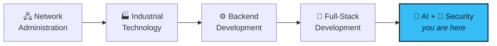

<!-- ═══════════════════════════ HEADER ═══════════════════════════ -->
<div align="center">


<a href="https://git.io/typing-svg">
  
</a>

<br/>


</div>

<!-- ═══════════════════════════ TERMINAL BIO ═══════════════════════════ -->

```bash
tahar@stockholm:~$ whoami
```

```yaml
name:        Tahar
role:        Developer
location:    Sweden 🇸🇪  (UTC+1/+2, powered by fika ☕)
origin_story: Network Admin ─▶ Industrial Tech ─▶ Backend ─▶ Full-Stack
focus:
  - Full-stack web apps (Next.js, React, Node, Prisma)
  - AI / ML and data analysis with Python
  - Local-first apps that respect your privacy
  - Games & hobby projects (Phaser, Godot)
currently:   studying AI & machine learning while building side projects
motto:       "Code today, conquer tomorrow."
```

<!-- ═══════════════════════════ JOURNEY ═══════════════════════════ -->

## 🗺️ The Quest So Far



> Every hop on that map left something behind: networking taught me how systems fail, industry taught me how they're *used*, and backend taught me how to build them.

<!-- ═══════════════════════════ TECH ARSENAL ═══════════════════════════ -->

## 🧰 Inventory

<div align="center">

| Slot | Equipped |
|:---:|:---|
| ⚔️ **Languages** |  |
| 🛡️ **Frameworks** |  |
| 🗄️ **Data** |  |
| 🧠 **AI / ML** |    |
| 🔧 **Toolbelt** |  |

</div>

<!-- ═══════════════════════════ PROJECTS ═══════════════════════════ -->

## 🚧 Projects

<table>
<tr>
<td width="50%" valign="top">

### 🧪 [VSRS](https://github.com/TahGue/VSRS-)
Verified Software Reasoning System — treats generated code as a hypothesis and verifies it with evidence.
`Python`

</td>
<td width="50%" valign="top">

### 🏭 [PLC Factory Emulator](https://github.com/TahGue/PLC_Emulator)
Open-source factory/PLC emulator with a FastAPI backend, PyTorch and PostgreSQL.
`Python · JavaScript · Docker`

</td>
</tr>
<tr>
<td width="50%" valign="top">

### 💰 [Financial Advisor](https://github.com/TahGue/FiscalYearReport)
Local-first budgeting app: bank CSV analysis, Swedish tax planning and AI explanations.
`Next.js · TypeScript`

</td>
<td width="50%" valign="top">

### 🧠 [AssessMind](https://github.com/TahGue/NeuroClear)
Web app for psychologists to manage patients, evaluations, scores and reports.
`TypeScript`

</td>
</tr>
<tr>
<td width="50%" valign="top">

### 🎧 [Audiobook Maker](https://github.com/TahGue/audiobook)
Local desktop app that turns PDF/EPUB/DOCX into audio with neural TTS, including Arabic.
`Python`

</td>
<td width="50%" valign="top">

### 🥾 [Utility Hiking App](https://github.com/TahGue/hikingmobileapp)
Offline-first app for hikers: maps, observations, safety warnings, species ID.
`Flutter · Dart`

</td>
</tr>
<tr>
<td width="50%" valign="top">

### ⚔️ [Malik RPG — The Drying Well](https://github.com/TahGue/rpg2dscroll)
Top-down pixel-art RPG with quests, crafting and combat.
`React · Phaser 3 · Express · Prisma`

</td>
<td width="50%" valign="top">

### 🖥️ [Kiosk System](https://github.com/TahGue/kiosk-server)
Node.js server + Linux clients for managing full-screen kiosk browsers.
`Node.js · Express`

</td>
</tr>
</table>

📚 Coursework: [ML assignments](https://github.com/TahGue/Assignment-2-for-Machine-Learning), [Olympic data analysis](https://github.com/TahGue/projekt_os_kanada), [statistics lab](https://github.com/TahGue/Laboration_Statistiska_Metoder), [SQL Server bookstore DB](https://github.com/TahGue/Lab2Databaser)

<!-- ═══════════════════════════ ACHIEVEMENTS ═══════════════════════════ -->

## 🏆 Achievements Unlocked

```diff
+ [UNLOCKED] Class Change ........ Network Admin → Full-Stack Developer
+ [UNLOCKED] Machine Learner ..... ML & data analysis projects in Python
+ [UNLOCKED] Builder ............. Full-stack apps from database to UI
+ [UNLOCKED] Game Dev ............ RPG in Phaser, survivors-like in Godot
- [LOCKED]   ??? ................. collaborate with me to find out
```

<!-- ═══════════════════════════ STATS ═══════════════════════════ -->

## 📡 Telemetry

<div align="center">
  
  
</div>

<div align="center">
  
</div>

<div align="center">
  
</div>

<div align="center">
  <picture>
    <source media="(prefers-color-scheme: dark)" srcset="https://raw.githubusercontent.com/TahGue/TahGue/output/github-snake-dark.svg" />
    <source media="(prefers-color-scheme: light)" srcset="https://raw.githubusercontent.com/TahGue/TahGue/output/github-snake.svg" />
    
  </picture>
</div>

<!-- ═══════════════════════════ PUZZLE ═══════════════════════════ -->

## 🧩 Side Quest: The Mirror Spell

> *A traveler hands you the scroll* `"Hello World"` *and asks for* `"dlroW olleH"` *— in a single line of Python.*

<details>
<summary><b>🔮 Level 1 — The Pythonista</b></summary>

```python
spell = scroll[::-1]
```
Slicing with a step of `-1`. Short, sharp, idiomatic.
</details>

<details>
<summary><b>🔮 Level 2 — The Functional Mage</b></summary>

```python
spell = "".join(reversed(scroll))
```
`reversed()` gives an iterator; `join` stitches it back together.
</details>

<details>
<summary><b>🔮 Level 3 — The Recursion Wizard</b></summary>

```python
mirror = lambda s: s and mirror(s[1:]) + s[0]
```
Elegant, slightly unhinged, and a stack overflow waiting to happen on long scrolls.
</details>

<details>
<summary><b>🔮 Boss Level — The Functional Lich</b></summary>

```python
from functools import reduce
spell = reduce(lambda acc, ch: ch + acc, scroll, "")
```
Folds each character onto the front of the accumulator.
</details>

**Found a weirder spell?** Open an issue or PR — the most creative one gets added here with credit. ✨

<!-- ═══════════════════════════ OFFLINE ═══════════════════════════ -->

## 🌲 When I'm Offline

<div align="center">

| 🏞️ | 🌍 | ☕ |
|:---:|:---:|:---:|
| **Trail mode**<br/>Hiking Sweden's forests & fjälls | **Explorer mode**<br/>New cultures & wildlife | **Fika mode**<br/>Deep talks on tech, life & everything |

</div>

<!-- ═══════════════════════════ CONNECT ═══════════════════════════ -->

## 📬 Open a Connection

```bash
tahar@stockholm:~$ ssh you@collaboration --port=always-open
```

<div align="center">

[](https://github.com/tahgue)
[](https://www.linkedin.com/in/YOUR-HANDLE)
[](mailto:YOUR-EMAIL)

<br/>


<br/>

**`// Building tomorrow's solutions with today's code`**


</div>
